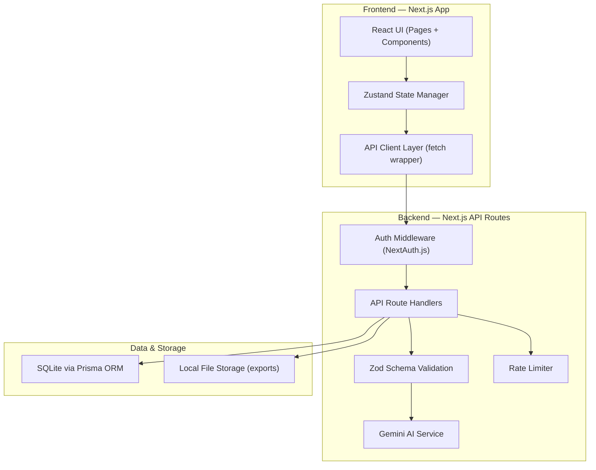
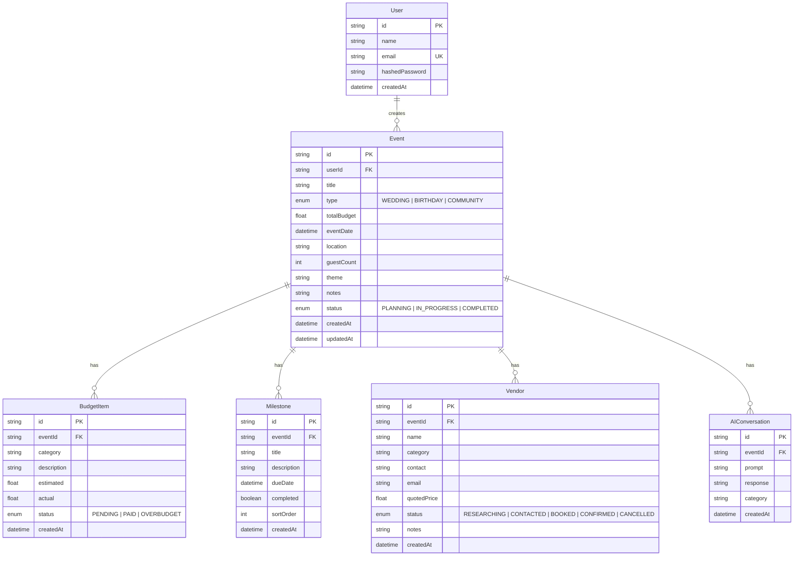

# 🎉 Challenge 5: Celebration & Event Planner — Implementation Plan

> **Goal**: Build a GenAI-powered planning assistant that helps users organize **weddings, birthdays, and community events** with **budgets, timelines, vendor checklists, and personalized ideas**.

---

## 1. Architecture Overview



### Why This Architecture?

| Decision | Rationale (Judging Criteria) |
|---|---|
| **Next.js (full-stack)** | Single codebase for frontend + API → **Code Quality** (maintainability) |
| **SQLite + Prisma** | Zero external DB dependency, type-safe queries → **Efficiency**, **Security** |
| **Zod validation** | Runtime type checking on all inputs → **Security** |
| **Zustand** | Minimal boilerplate state management → **Code Quality**, **Efficiency** |
| **NextAuth.js** | Battle-tested auth with CSRF protection → **Security** |
| **Rate limiting** | Prevents AI API abuse → **Security**, **Efficiency** |

---

## 2. Tech Stack

| Layer | Technology | Version |
|---|---|---|
| Framework | Next.js (App Router) | 14.x |
| Language | TypeScript (strict mode) | 5.x |
| Styling | Vanilla CSS (CSS Modules) | — |
| State | Zustand | 4.x |
| Database | SQLite + Prisma ORM | Prisma 5.x |
| Auth | NextAuth.js | 4.x |
| AI | Google Gemini API (`@google/generative-ai`) | Latest |
| Validation | Zod | 3.x |
| Testing | Vitest + React Testing Library + Playwright | Latest |
| Linting | ESLint + Prettier | Latest |
| Accessibility | axe-core (automated a11y testing) | Latest |

---

## 3. Project Structure

```
Challenge 5/
├── .env.local                    # Environment variables (GITIGNORED)
├── .env.example                  # Template for required env vars
├── next.config.js
├── tsconfig.json
├── prisma/
│   ├── schema.prisma             # Database schema
│   ├── seed.ts                   # Seed data (sample vendors, templates)
│   └── migrations/               # Auto-generated migrations
├── public/
│   ├── favicon.ico
│   └── assets/                   # Static images, icons
├── src/
│   ├── app/                      # Next.js App Router
│   │   ├── layout.tsx            # Root layout (fonts, metadata, providers)
│   │   ├── page.tsx              # Landing / Dashboard page
│   │   ├── globals.css           # Global CSS + design tokens
│   │   ├── events/
│   │   │   ├── page.tsx          # Events list
│   │   │   ├── new/
│   │   │   │   └── page.tsx      # Create new event (wizard)
│   │   │   └── [id]/
│   │   │       ├── page.tsx      # Event dashboard
│   │   │       ├── budget/
│   │   │       │   └── page.tsx  # Budget tracker
│   │   │       ├── timeline/
│   │   │       │   └── page.tsx  # Timeline / milestones
│   │   │       ├── vendors/
│   │   │       │   └── page.tsx  # Vendor checklist
│   │   │       └── ideas/
│   │   │           └── page.tsx  # AI-generated ideas
│   │   ├── api/
│   │   │   ├── auth/
│   │   │   │   └── [...nextauth]/route.ts
│   │   │   ├── events/
│   │   │   │   ├── route.ts      # CRUD events
│   │   │   │   └── [id]/
│   │   │   │       ├── route.ts
│   │   │   │       ├── budget/route.ts
│   │   │   │       ├── timeline/route.ts
│   │   │   │       └── vendors/route.ts
│   │   │   └── ai/
│   │   │       ├── generate-plan/route.ts
│   │   │       ├── suggest-ideas/route.ts
│   │   │       ├── budget-optimize/route.ts
│   │   │       └── vendor-recommend/route.ts
│   │   └── error.tsx             # Global error boundary
│   ├── components/
│   │   ├── ui/                   # Reusable primitives
│   │   │   ├── Button.tsx
│   │   │   ├── Button.module.css
│   │   │   ├── Card.tsx
│   │   │   ├── Input.tsx
│   │   │   ├── Modal.tsx
│   │   │   ├── ProgressBar.tsx
│   │   │   ├── Badge.tsx
│   │   │   ├── Toast.tsx
│   │   │   └── Skeleton.tsx      # Loading skeletons
│   │   ├── layout/
│   │   │   ├── Navbar.tsx
│   │   │   ├── Sidebar.tsx
│   │   │   └── Footer.tsx
│   │   ├── events/
│   │   │   ├── EventCard.tsx
│   │   │   ├── EventWizard.tsx   # Multi-step creation wizard
│   │   │   └── EventTypeSelector.tsx
│   │   ├── budget/
│   │   │   ├── BudgetOverview.tsx
│   │   │   ├── BudgetCategoryChart.tsx
│   │   │   └── ExpenseItem.tsx
│   │   ├── timeline/
│   │   │   ├── TimelineView.tsx
│   │   │   ├── MilestoneCard.tsx
│   │   │   └── CountdownTimer.tsx
│   │   ├── vendors/
│   │   │   ├── VendorChecklist.tsx
│   │   │   ├── VendorCard.tsx
│   │   │   └── VendorStatusBadge.tsx
│   │   └── ai/
│   │       ├── AIChatPanel.tsx       # Conversational AI panel
│   │       ├── IdeaSuggestionCard.tsx
│   │       └── AILoadingIndicator.tsx
│   ├── lib/
│   │   ├── prisma.ts             # Prisma singleton
│   │   ├── gemini.ts             # Gemini AI client + prompt templates
│   │   ├── auth.ts               # NextAuth config
│   │   ├── rate-limiter.ts       # Token bucket rate limiter
│   │   ├── sanitize.ts           # Input sanitization helpers
│   │   ├── constants.ts          # App-wide constants
│   │   └── utils.ts              # Utility functions
│   ├── schemas/                  # Zod validation schemas
│   │   ├── event.schema.ts
│   │   ├── budget.schema.ts
│   │   ├── timeline.schema.ts
│   │   └── vendor.schema.ts
│   ├── stores/                   # Zustand stores
│   │   ├── eventStore.ts
│   │   ├── budgetStore.ts
│   │   └── uiStore.ts
│   ├── hooks/                    # Custom React hooks
│   │   ├── useEvent.ts
│   │   ├── useBudget.ts
│   │   ├── useAI.ts
│   │   └── useDebounce.ts
│   └── types/                    # TypeScript type definitions
│       ├── event.types.ts
│       ├── budget.types.ts
│       └── ai.types.ts
├── tests/
│   ├── unit/
│   │   ├── schemas/              # Zod schema validation tests
│   │   ├── lib/                  # Utility function tests
│   │   └── components/           # Component unit tests
│   ├── integration/
│   │   ├── api/                  # API route tests
│   │   └── ai/                   # AI service tests (mocked)
│   └── e2e/
│       ├── event-creation.spec.ts
│       ├── budget-tracking.spec.ts
│       └── accessibility.spec.ts # axe-core a11y tests
├── vitest.config.ts
├── playwright.config.ts
└── README.md                     # Documentation
```

---

## 4. Database Schema (Prisma)



---

## 5. Feature Breakdown & Problem Statement Alignment

> [!IMPORTANT]
> Every feature below maps directly to the problem statement requirements: **budgets, timelines, vendor checklists, and personalized ideas**.

### 5.1 Event Creation Wizard 🧙

| Requirement | Feature |
|---|---|
| **Organize weddings, birthdays, community events** | Multi-step wizard with event type selector (Wedding/Birthday/Community) |
| **Personalized ideas** | AI generates a customized plan based on type, budget, guest count, theme |

**Flow:**
1. Select event type → 2. Enter details (date, budget, guests, theme) → 3. AI generates initial plan → 4. Review & customize → 5. Save event

### 5.2 Budget Tracker 💰

| Requirement | Feature |
|---|---|
| **Budgets** | Full budget management with categories, estimates vs. actuals |
| **Personalized ideas** | AI suggests budget allocation based on event type + priorities |

**Features:**
- Category breakdown (venue, catering, decor, entertainment, etc.)
- Visual spending chart (pie/bar)
- Over-budget warnings with AI optimization suggestions
- Export budget report as CSV

### 5.3 Timeline & Milestones 📅

| Requirement | Feature |
|---|---|
| **Timelines** | Interactive timeline with milestones and countdown |
| **Personalized ideas** | AI generates milestones based on event date + type |

**Features:**
- Auto-generated milestone templates per event type
- Drag-to-reorder milestones
- Countdown timer to event day
- Overdue milestone alerts

### 5.4 Vendor Checklist ✅

| Requirement | Feature |
|---|---|
| **Vendor checklists** | Vendor tracking with status pipeline |
| **Personalized ideas** | AI suggests required vendor categories per event type |

**Features:**
- Status pipeline: Researching → Contacted → Booked → Confirmed
- Category-based vendor grouping
- Contact info & price tracking
- AI-recommended vendor categories based on event type

### 5.5 AI-Powered Planning Assistant 🤖

| Requirement | Feature |
|---|---|
| **GenAI-powered** | Conversational AI panel powered by Gemini |
| **Personalized ideas** | Context-aware suggestions using full event data |

**AI Capabilities:**
1. **Generate Full Plan** — Creates budget breakdown + timeline + vendor list from event details
2. **Suggest Ideas** — Theme ideas, decoration suggestions, entertainment options
3. **Budget Optimizer** — Suggests cost savings without compromising quality
4. **Vendor Recommendations** — Suggests vendor categories you might have missed
5. **Contextual Chat** — Ask questions about your specific event

---

## 6. Security Model

> [!CAUTION]
> Security is a primary judging criterion. Every layer implements defense-in-depth.

### 6.1 Input Validation & Sanitization

```
Every API request → Zod Schema Validation → Sanitize strings → Process
```

- **All** API inputs validated with Zod schemas before processing
- HTML/script injection prevention via DOMPurify-style sanitization
- SQL injection prevented by Prisma's parameterized queries (never raw SQL)
- Maximum input length enforcement on all text fields

### 6.2 Authentication & Authorization

- NextAuth.js with credentials provider (email/password)
- Passwords hashed with bcrypt (12 salt rounds)
- JWT session tokens with short expiry (24h)
- CSRF protection built into NextAuth
- Every API route validates session + ownership (user can only access their own events)

### 6.3 API Security

- **Rate limiting**: Token bucket algorithm — 30 requests/minute per user for AI endpoints
- **API key protection**: Gemini API key stored in `.env.local`, never exposed to client
- **CORS**: Restricted to same-origin
- **Content-Security-Policy headers** via `next.config.js`
- **No sensitive data in client bundles**: All AI calls go through server API routes

### 6.4 AI Safety

- **Prompt injection prevention**: System prompts are hardcoded; user input is clearly delineated with markers
- **Output sanitization**: AI responses are sanitized before rendering
- **Content filtering**: Gemini's built-in safety settings enabled at BLOCK_MEDIUM_AND_ABOVE
- **Token limits**: Max output tokens capped to prevent resource abuse

### 6.5 Environment & Secrets

```
.env.example (committed — template only)
.env.local   (GITIGNORED — actual secrets)
```

- `.env.example` with placeholder values committed
- `.env.local` with real keys gitignored
- Runtime validation that all required env vars are present at startup

---

## 7. Efficiency Strategy

### 7.1 Database

- SQLite = zero network latency for DB queries
- Prisma query optimization with `select` (fetch only needed fields)
- Database indexes on frequently queried fields (`userId`, `eventId`, `status`)

### 7.2 Frontend

- Next.js App Router with Server Components (reduce client JS)
- Dynamic imports for heavy components (charts, AI panel)
- Skeleton loading states (no layout shift)
- Debounced search/filter inputs
- Optimistic UI updates for CRUD operations

### 7.3 AI

- **Structured prompts** with specific output formats (JSON) to reduce token usage
- **Caching**: Cache identical AI requests in DB to avoid redundant API calls
- **Streaming**: Use Gemini streaming API for chat responses (better UX, same cost)
- **Temperature tuning**: Low temperature (0.3-0.5) for structured outputs, higher (0.7) for creative ideas

---

## 8. Accessibility (WCAG 2.1 AA)

| Requirement | Implementation |
|---|---|
| **Keyboard navigation** | All interactive elements focusable, proper tab order, skip-to-content link |
| **Screen readers** | Semantic HTML5 elements, ARIA labels, live regions for dynamic content |
| **Color contrast** | Minimum 4.5:1 ratio for normal text, 3:1 for large text |
| **Focus indicators** | Visible focus rings on all interactive elements |
| **Responsive design** | Mobile-first, works at 320px+ viewport |
| **Motion preferences** | `prefers-reduced-motion` media query respected |
| **Form labels** | Every input has an associated `<label>` |
| **Error messages** | Clear, descriptive error messages tied to inputs via `aria-describedby` |
| **Automated testing** | axe-core in Playwright tests to catch regressions |

---

## 9. Testing Strategy

### 9.1 Unit Tests (Vitest)

| Target | What's Tested |
|---|---|
| `schemas/*.schema.ts` | Valid/invalid input validation, edge cases, type coercion |
| `lib/rate-limiter.ts` | Token bucket behavior, window reset, concurrent access |
| `lib/sanitize.ts` | XSS prevention, script tag removal, attribute stripping |
| `lib/utils.ts` | Utility functions (date formatting, currency, etc.) |
| `components/ui/*` | Rendering, prop variants, accessibility attributes |

### 9.2 Integration Tests (Vitest + MSW)

| Target | What's Tested |
|---|---|
| `api/events/*` | CRUD operations, auth enforcement, validation errors |
| `api/ai/*` | Prompt construction, rate limiting, error handling, mocked Gemini responses |
| `stores/*` | State transitions, computed values |

### 9.3 E2E Tests (Playwright)

| Scenario | Coverage |
|---|---|
| Event creation wizard | Full happy path from type selection to AI plan generation |
| Budget management | Add/edit/delete expenses, over-budget warning |
| Timeline management | Add milestones, mark complete, reorder |
| Vendor checklist | Add vendor, update status through pipeline |
| Accessibility | axe-core scans on every page |
| Auth flow | Login, protected routes, logout |

### 9.4 Test Coverage Target

- **Unit**: 80%+ coverage on `lib/`, `schemas/`, utility functions
- **Integration**: All API routes tested for happy path + error cases
- **E2E**: Critical user journeys covered

---

## 10. Build Order (Step-by-Step)

> [!NOTE]
> Each phase produces a working, testable increment.

### Phase 1: Foundation (Steps 1-4)
| Step | Task | Files |
|---|---|---|
| 1 | Initialize Next.js project with TypeScript | `next.config.js`, `tsconfig.json`, `package.json` |
| 2 | Set up Prisma + SQLite + database schema | `prisma/schema.prisma`, `src/lib/prisma.ts` |
| 3 | Set up NextAuth.js authentication | `src/lib/auth.ts`, `src/app/api/auth/` |
| 4 | Create design system (CSS tokens + UI components) | `globals.css`, `src/components/ui/*` |

### Phase 2: Core Features (Steps 5-8)
| Step | Task | Files |
|---|---|---|
| 5 | Build Event CRUD (API + pages) | `src/app/api/events/`, `src/app/events/` |
| 6 | Build Event Creation Wizard | `src/components/events/EventWizard.tsx` |
| 7 | Build Budget Tracker (API + UI + charts) | `src/app/api/events/[id]/budget/`, budget components |
| 8 | Build Timeline Manager (API + UI) | `src/app/api/events/[id]/timeline/`, timeline components |

### Phase 3: Vendor & AI (Steps 9-11)
| Step | Task | Files |
|---|---|---|
| 9 | Build Vendor Checklist (API + UI) | `src/app/api/events/[id]/vendors/`, vendor components |
| 10 | Integrate Gemini AI (service + prompts) | `src/lib/gemini.ts`, `src/app/api/ai/*` |
| 11 | Build AI Chat Panel + idea generation UI | `src/components/ai/*`, `src/app/events/[id]/ideas/` |

### Phase 4: Security & Polish (Steps 12-14)
| Step | Task | Files |
|---|---|---|
| 12 | Add rate limiting, input sanitization, CSP headers | `src/lib/rate-limiter.ts`, `src/lib/sanitize.ts` |
| 13 | Add Zod validation to all API routes | `src/schemas/*` |
| 14 | Accessibility audit + responsive design polish | All UI files |

### Phase 5: Testing & Documentation (Steps 15-17)
| Step | Task | Files |
|---|---|---|
| 15 | Write unit tests | `tests/unit/*` |
| 16 | Write integration + E2E tests | `tests/integration/*`, `tests/e2e/*` |
| 17 | Write README with setup instructions, architecture docs, screenshots | `README.md` |

---

## 11. AI Prompt Engineering

> [!TIP]
> Well-structured prompts are critical for consistent, useful AI output.

### System Prompt Template (Plan Generation)

```
You are an expert event planner AI assistant. You help users plan 
{eventType} events. Based on the following event details, generate 
a comprehensive plan.

EVENT DETAILS:
- Type: {eventType}
- Date: {eventDate}
- Budget: ${totalBudget}
- Guest Count: {guestCount}
- Theme: {theme}
- Location: {location}
- Special Notes: {notes}

Respond ONLY with valid JSON in this exact format:
{
  "budgetBreakdown": [
    {"category": "...", "amount": ..., "percentage": ..., "tips": "..."}
  ],
  "milestones": [
    {"title": "...", "description": "...", "daysBeforeEvent": ..., "priority": "HIGH|MEDIUM|LOW"}
  ],
  "vendorCategories": [
    {"category": "...", "priority": "ESSENTIAL|RECOMMENDED|OPTIONAL", "budgetRange": "..."}
  ],
  "themeIdeas": ["...", "...", "..."],
  "tips": ["...", "...", "..."]
}
```

### Prompt Injection Prevention

```typescript
// User input is NEVER interpolated into the system prompt directly
const messages = [
  { role: "system", content: HARDCODED_SYSTEM_PROMPT },
  { role: "user", content: `Event details:\n${JSON.stringify(sanitizedInput)}` }
];
```

---

## 12. Scoring Alignment Summary

| Criterion | How We Address It | Score Target |
|---|---|---|
| **Problem Statement Alignment** | All 4 requirements (budgets, timelines, vendors, personalized ideas) are core features. GenAI powers every feature. | ⭐⭐⭐⭐⭐ |
| **Code Quality** | TypeScript strict mode, clear project structure, CSS Modules, Prisma ORM, Zod schemas, ESLint/Prettier, separation of concerns | ⭐⭐⭐⭐⭐ |
| **Security** | Auth (NextAuth), input validation (Zod), sanitization, rate limiting, CSP headers, prompt injection prevention, env var protection | ⭐⭐⭐⭐⭐ |
| **Efficiency** | SQLite (zero latency), Server Components, dynamic imports, AI response caching, streaming, structured prompts | ⭐⭐⭐⭐⭐ |
| **Testing** | Unit (Vitest), Integration (MSW), E2E (Playwright), Accessibility (axe-core), 80%+ coverage target | ⭐⭐⭐⭐ |
| **Accessibility** | WCAG 2.1 AA, keyboard nav, screen readers, contrast, focus indicators, reduced motion, automated testing | ⭐⭐⭐⭐ |

---

## 13. Key Decisions Needed From You

1. **Gemini API Key** — Do you already have a Google AI Studio API key, or do you need to create one?
2. **Auth Complexity** — Full email/password auth or simpler demo-mode auth (local-only, no real passwords)?
3. **Deployment** — Will you deploy this (Vercel, etc.) or demonstrate locally only?
4. **Scope** — Should I build ALL features above, or start with a focused MVP and iterate?
